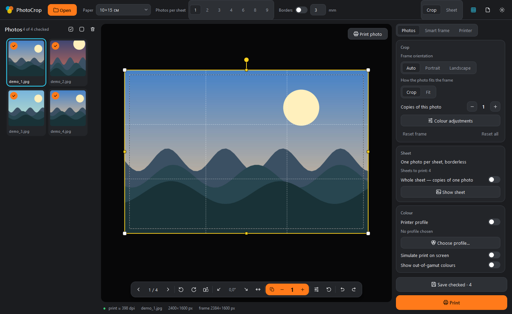
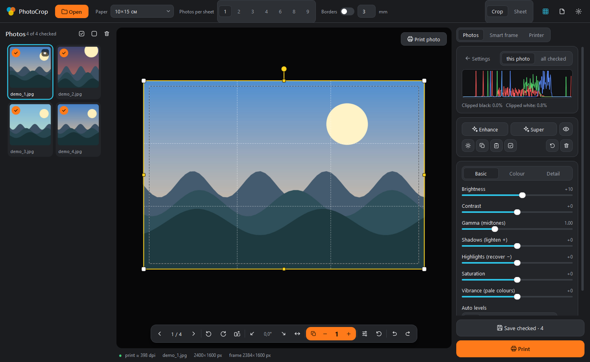
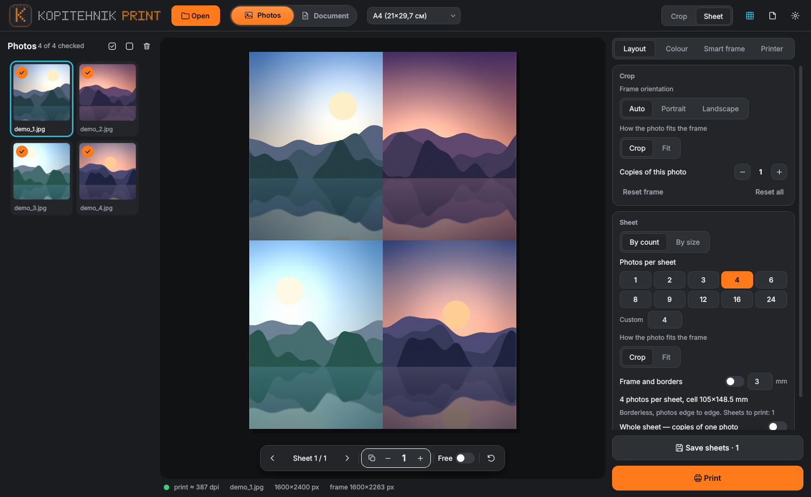
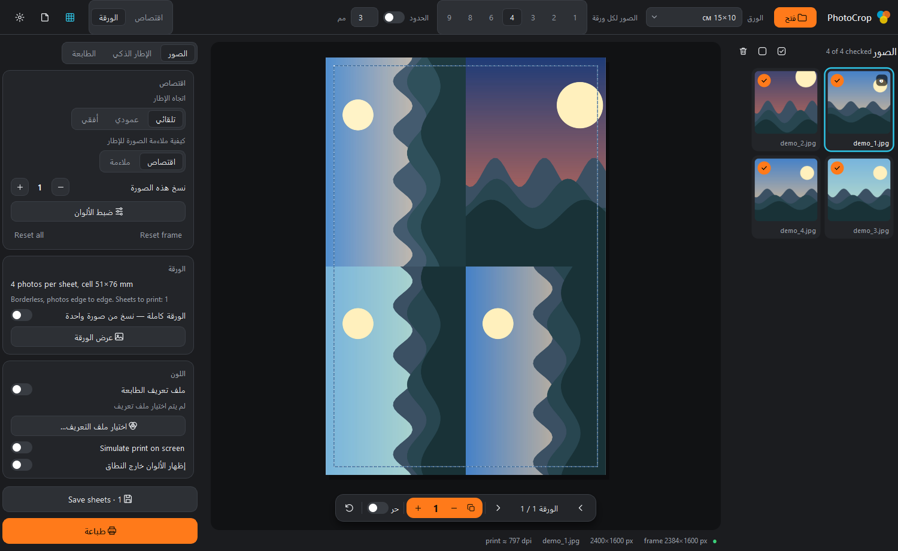
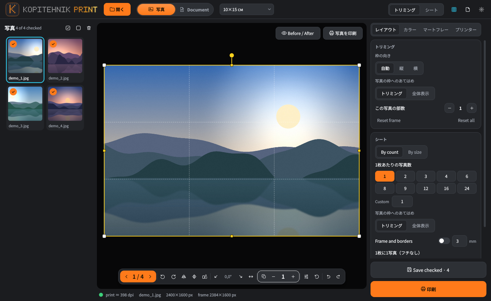

[English](README.md) | [Русский](README.ru.md) | [Español](README.es.md) | [简体中文](README.zh-CN.md) | [繁體中文](README.zh-Hant.md) | [Deutsch](README.de.md) | [Français](README.fr.md) | **Português** | [日本語](README.ja.md) | [한국어](README.ko.md) | [Türkçe](README.tr.md) | [Bahasa Indonesia](README.id.md) | [العربية](README.ar.md) | [हिन्दी](README.hi.md) | [Italiano](README.it.md) | [Polski](README.pl.md) | [Українська](README.uk.md) | [Tiếng Việt](README.vi.md) | [ไทย](README.th.md) | [Татарча](README.tt.md)

# PhotoCrop (КопиТехник PRINT)

Programa para Windows para recortar e imprimir fotos (10×15 cm e outros formatos), com recorte inteligente, correção de cor, perfis de cor, layout de impressão e modo de agente de IA.

**License: [KopiTehnik Print Licence](LICENSE)**

## Screenshots

<p align="center"></p>







| Arabic (right-to-left) | Japanese |
|---|---|
|  |  |
## Recursos

- Formatos de impressão: 10×15, 9×13, 13×18, 15×21, 20×30, 30×40 cm, A5, A4, A3, A3+, A2 (recortar para preencher a folha ou ajustar a foto inteira).
- Recorte inteligente: detecção de rostos (YuNet), pessoas e animais (YOLOX), modelo de pose; o quadro também pode ser definido manualmente.
- Correção de cor por foto: brilho, contraste, gama, sombras/realces, saturação, temperatura/matiz, RGB, automático, preto e branco, sépia, redução de ruído, nitidez.
- Gestão de cor: perfil ICC da impressora e chave do Windows ICM.
- Planejamento de impressão: várias fotos por folha, sangria por lado, um trabalho por folha com pausa, verificações antes de imprimir (dpi, encaixe).
- Exportação para JPEG, TIFF, PNG e PDF.
- Modo agente de IA: cada etapa é um comando que devolve JSON (linha de comando ou servidor MCP para o Claude Desktop). Veja [AGENT.md](AGENT.md) (em russo).
- Idiomas da interface na versão Qt: Русский, English, 日本語, 한국어, Türkçe, Bahasa Indonesia, العربية, हिन्दी, Italiano, Polski, Українська, Tiếng Việt, ไทย, 繁體中文, Татарча (escolha em Configurações; por padrão o idioma do sistema; o árabe é exibido da direita para a esquerda). As traduções cobrem as telas principais, são automáticas e ainda não foram revisadas por falantes nativos; textos sem tradução aparecem em inglês.

## Instalação

- Windows com Python 3.9+ ("Add python.exe to PATH"), ou execute `install.bat`: ele instala o Python (se faltar), os pacotes e cria atalhos. É necessária internet.
- Instalação manual: `pip install -r requirements.txt`.

## Executar a versão Qt

Dê dois cliques em `run_qt.bat` (instala Pillow, pillow-heif, PySide6 e inicia `photo_crop_qt.py`). Autoteste: `selftest_qt.bat`. A janela antiga em Tkinter: `python photo_crop.py`.

### Modelos de detecção

Os modelos YuNet / YOLOX (~36 MB) não estão no repositório; são baixados no primeiro uso (ou com `python smart_crop.py setup`) para `%APPDATA%\PhotoCrop\models`.

## Modo agente e MCP

Execute `mcp_config.bat` (ou `python photo_crop.py mcp-config`) para obter o bloco de configuração, adicione-o ao `claude_desktop_config.json` (`%APPDATA%\Claude\`) e reinicie o Claude Desktop. Para o exe compilado, o bloco `mcpServers.photocrop` é:

```json
{
  "mcpServers": {
    "photocrop": {
      "command": "C:\\path\\to\\PhotoCropAgent.exe",
      "args": ["mcp"]
    }
  }
}
```

Comandos principais: `open_folder`, `set_format`, `auto_crop`, `set_crop`, `set_adjust`, `select_printer`, `plan_print`, `render_sheet`, `preflight`, `print`.

Linha de comando: `python photo_crop.py agent set_format format=10x15`; `python photo_crop.py agent --list` lista todos os comandos. O estado fica em `%APPDATA%\PhotoCrop\agent_state.json`. `PHOTOCROP_AGENT_DRYRUN=1` proíbe a impressão real.

## Compilar os exe

`build_exe.bat` compila com o PyInstaller `PhotoCrop.exe` (janela Tkinter) e `PhotoCropAgent.exe` (console, para MCP). Atenção: depois o script apaga `build\` e os arquivos `.spec`. A versão Qt é compilada com `pyinstaller PhotoCropQt.spec` → `dist\PhotoCropQt.exe`. Uma tag `v*` dispara o fluxo do GitHub Actions (`.github/workflows/build.yml`), que compila `PhotoCropQt.exe` e `PhotoCropAgent.exe` e os anexa a um GitHub Release.

## Licença

License: [KopiTehnik Print Licence](LICENSE)
